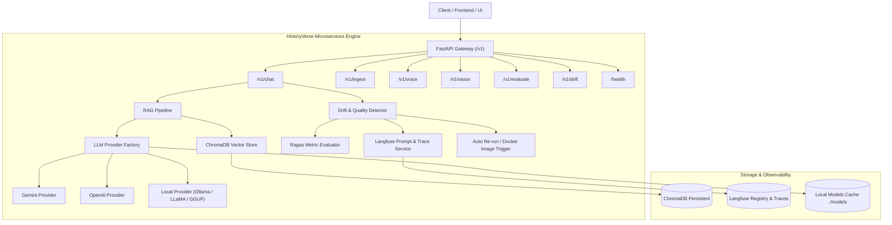

# HistoryVerse Microservices — Master Execution Plan

## Architecture Diagram

## Phased Checklist

### Phase 1: Environment & Project Scaffolding
- [x] Project directory setup: `src/`, `tests/`, `configs/`, `models/`, `outputs/`, `dataset/`, `extracted/`
- [x] `pyproject.toml` with `uv`, `ruff`, and `pytest` configurations
- [x] `.env.example`, `.gitignore`, `.dockerignore`
- [x] `CONTRIBUTING.md`, `INTENT.md`, `PLAN.md`
- [x] Migration of legacy documents to `dataset/`

### Phase 2: Configuration & Core Domain Model
- [x] `historyverse.config.settings`: Pydantic Settings with env parsing and secret masking
- [x] `historyverse.core.enums`: Provider, ConversationType, DeviceType, DriftAction
- [x] `historyverse.core.exceptions`: Hierarchical typed exceptions
- [x] `historyverse.core.schemas`: Pydantic v2 validation models
- [x] `historyverse.core.base`: Abstract Base Classes (LLM, Embedding, STT, TTS)

### Phase 3: Model-Agnostic LLM Engine & Local Downloader
- [x] `BaseLLMProvider` interface with confidence calculation
- [x] `GeminiProvider`: Google Gemini 1.5 Flash/Pro with multimodal support
- [x] `OpenAIProvider`: OpenAI GPT-4o / GPT-4o-mini
- [x] `LocalProvider`: GGUF / LLaMA / Ollama with automatic model downloading
- [x] `LLMFactory`: Dynamic provider instantiation based on environment configuration

### Phase 4: Langfuse Observability & Prompt Versioning
- [x] `LangfuseClient`: Singleton client with graceful fallback for offline dev
- [x] `PromptManager`: Versioned prompt management (System & User prompts) with local YAML fallback
- [x] `Tracer`: Latency, token usage, and metadata tracking decorators
- [x] Declarative prompt templates in `configs/prompts/`

### Phase 5: RAG Pipeline & Resource Control
- [x] `DocumentIngestor`: Multi-format batch loader with CPU-aware thread & process pooling
- [x] `ChromaRetriever`: Configurable vector store wrapper with similarity search
- [x] `RAGPipeline`: Retrieval + context synthesis + prompt formatting

### Phase 6: Drift Detection, Hallucination Control & Ragas Evaluation
- [x] `DriftDetector`: Response confidence monitoring and heuristic drift analysis
- [x] `RagasEvaluator`: Faithfulness, answer relevancy, context recall, and precision scoring
- [x] Auto-retry loop: Re-run generation with adjusted parameters or fallback model on low score
- [x] Drift action executor: Operator alert notification and container rebuild trigger hook

### Phase 7: Voice (STT / TTS) & Vision Microservices
- [x] `WhisperSTT`: Faster-Whisper lazy loading and CPU-friendly inference
- [x] `GTTSTextToSpeech`: Multi-lingual speech synthesis with auto-language detection
- [x] `ImageAnalyzer`: Multimodal historical monument / artifact query handler
- [x] `ConversationMemory`: Per-session bounded memory buffer

### Phase 8: FastAPI API Gateway
- [x] Application factory with lifespan and structured request logging
- [x] Global error handling middleware converting typed exceptions to HTTP responses
- [x] Route handlers: `/v1/chat`, `/v1/ingest`, `/v1/voice`, `/v1/vision`, `/v1/evaluate`, `/v1/drift`, `/health`
- [x] Dependency injection container for all service singletons

### Phase 9: Testing Suite & Quality Verification
- [x] Pytest fixtures in `tests/conftest.py`
- [x] Unit tests for config, schemas, LLM factory, memory, drift detection, hallucination
- [x] Integration tests for FastAPI endpoints and ingestion pipeline
- [x] Ruff lint and style conformity

### Phase 10: Dockerization & CI/CD Pipeline
- [x] Production multi-stage `Dockerfile`
- [x] `docker-compose.yml` orchestrating API and ChromaDB services
- [x] GitHub Actions workflow `.github/workflows/ci.yml` (lint + test + build)
- [x] GitHub Actions workflow `.github/workflows/pr-policy.yml` (commit validation & author attribution policy)

### Phase 11: Governance & Operational Documentation
- [x] `docs/CODE_MAP.md`: Index of modules and roles
- [x] `docs/GITHUB_OPERATING_MODEL.md`: Branching, PR criteria, manual merge rules
- [x] `docs/RUNBOOKS.md`: Maintenance, model additions, and drift recovery procedures
- [x] `scripts/docs_log.py`: Automated changelog and bug tracking script
