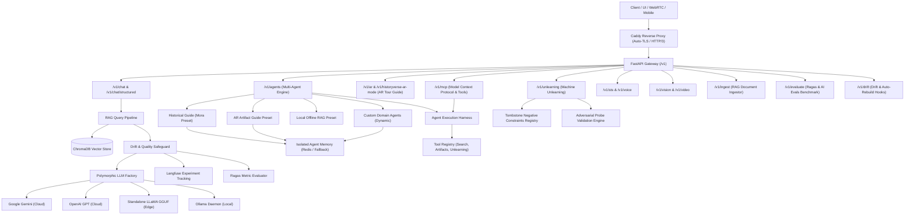

# Agent AI — Domain-Agnostic Multimodal Agent Platform

[](https://www.python.org/)
[](https://github.com/astral-sh/ruff)
[](tests/)
[](docker-compose.yml)
[](https://github.com/omarMohamedo-o)

**Agent AI** is an enterprise-grade, domain-agnostic, and model-agnostic multimodal agent microservice framework. It enables the declarative instantiation of specialized AI agents for arbitrary operational domains (e.g. historical analysis, museum augmented reality, offline local RAG, legal, medical, and scientific research) with dedicated personas, isolated memory, and custom LLM provider backends (Google Gemini, OpenAI GPT, quantized LLaMA GGUF, and Ollama daemons).

---

## Architectural Evolution & Lineage

Agent AI unifies and modernizes predecessor open-source repositories into a domain-agnostic microservice platform:

1. **[HistoryVerse-Chatbot](https://github.com/omarMohamedo-o/HistoryVerse-Chatbot)**:
   - Provided core RAG retrieval pipelines, Google Gemini integration, Prompt versioning with Langfuse, and conversational API routes.
2. **[HistoryVerse-LocalChatbot](https://github.com/omarMohamedo-o/HistoryVerse-LocalChatbot)**:
   - Provided offline local inference, standalone LLaMA GGUF quantized models (`llama-cpp-python`), Ollama daemon management, and edge memory.

### The Agent 2.0 Engine
Rather than coupling the codebase to a single knowledge domain, **Agent** abstracts agent generation into declarative YAML templates ([`AgentTemplate`](src/agent/services/agents/template.py)) executed by universal engines ([`TemplatedAgent`](src/agent/services/agents/template.py), [`DomainAgent`](src/agent/services/agents/domain.py), and [`AgentOrchestrator`](src/agent/services/agents/orchestrator.py)). Domain applications like the Historical Mora Guide, Museum AR Tour Guide, and Offline Local RAG are implemented as declarative presets in `configs/prompts/`.

---

## System Architecture



---

## Core Capabilities

### 1. Model-Agnostic LLM Engine
- Switch seamlessly between `gemini`, `openai`, `local` (standalone GGUF weights), or `ollama` via `.env` or Vault secrets.
- Missing local model weights are automatically detected and downloaded from HuggingFace Hub.
- Hardware targeting: `cpu`, `cuda`, `mps`, or `auto`.

### 2. Isolated Multi-Agent Orchestration
- **Strict Memory Isolation**: Each agent possesses its own namespaced memory (`{agent_id}::{session_id}`), preventing cross-agent context contamination.
- **Collaborative Team Pipelines**: Archival Researcher retrieves evidence -> Domain Persona synthesizes insights -> Critic evaluates factual grounding and hallucination scores.
- **Dynamic Domain Model Generation**: Dynamically spawn custom specialized agents with dedicated prompts and assigned LLM backends at runtime.

### 3. Machine Unlearning & Validation Engine
- **Selective Forgetting**: Eradicate retracted claims, hallucinated data, or confidential information across conversational memory, Redis, and ChromaDB vector embeddings.
- **Tombstone Negative Constraints**: Enforces active anti-knowledge guards preventing models from resurrecting unlearned facts.
- **Adversarial Probe Validation**: Automatically interrogates models with direct, leading, and contextual probes, calculates token leakage rates, verifies vector residuals, and issues cryptographic `CERT-UNLEARN` audit certificates.

### 4. Model Context Protocol (MCP) & Agent Harness
- **Standard MCP Protocol**: Compliant JSON-RPC 2.0 interface supporting `tools/list`, `tools/call`, `resources/list`, and `resources/read`. External tools, IDEs, and agentic platforms can interact directly with Agent.
- **Harness Engineering Principles**: Defensive tool sandboxing, input schema validation, execution latency tracking, and error-recovery in the ReAct observation loop.
- **RAG as an MCP Tool**: Domain archives, artifacts, and unlearning verification exposed as standardized callable tools.

### 5. AI Evaluation Benchmark Suite (`evals/`)
- **Golden Evaluation Datasets**: Industry-standard `.jsonl` benchmark containing curated test cases across factuality, hallucination traps, and unlearning compliance.
- **RAG Triad Metrics**: Context relevance, faithfulness (groundedness), and answer relevance.
- **CLI Runner**: `python -m evals.runner` outputs structured markdown and JSON audit summaries.

### 6. Context Budgeting & Structured Output
- **Token Budget Management**: Dynamic token counting (tiktoken / fast heuristic) and context budget trimming preventing prompt window overflow.
- **Pydantic Schema Validation**: Structured JSON endpoints (`/v1/chat/structured`) yielding schema-validated entities, eras, citations, and confidence scores.

### 7. Multimodal Audio, Vision & Video
- **Speech-to-Speech (STS)**: Real-time audio streaming input/output via Faster-Whisper and gTTS.
- **Multimodal Vision**: High-resolution image artifact and site analysis.
- **Video Inspection**: Keyframe temporal extraction and architectural scene inspection.

### 8. Enterprise Self-Healing & Infrastructure
- **Caddy Auto-TLS**: Zero-configuration automated Let's Encrypt / ZeroSSL TLS certificates and HTTP/3 reverse proxy (replaces legacy Nginx + Certbot).
- **Smartheal & Heartbeat**: Self-healing supervisor daemons monitoring service health and auto-restarting degraded containers.
- **Storage Guardian**: Automated disk space pruning and Docker cleanups.
- **HashiCorp Vault**: Production AppRole token and secret resolution.

---

## API Reference

| Method | Endpoint | Description |
|---|---|---|
| `GET` | `/health` | Service health status, active provider, model name, and uptime |
| `POST` | `/v1/chat` | Conversational RAG query with drift detection and memory |
| `POST` | `/v1/chat/structured` | Schema-validated structured JSON analysis |
| `POST` | `/v1/ar/start` | Initialize guided AR exploration for detected objects/statues |
| `POST` | `/v1/ar/chat` | Contextually scoped question-answering for active AR artifact |
| `POST` | `/v1/mcp` | Standard Model Context Protocol JSON-RPC 2.0 endpoint |
| `GET` | `/v1/mcp/tools` | List all available MCP tools in standard format |
| `POST` | `/v1/mcp/tools/{tool_name}/execute` | Execute a tool directly through the sandboxed Agent Harness |
| `POST` | `/v1/mcp/agent/run` | Execute an agent equipped with tool-calling harness capabilities |
| `POST` | `/v1/agents/team/run` | Collaborative multi-agent team execution (Researcher -> Guide -> Critic) |
| `POST` | `/v1/agents/{agent_id}/run` | Execute a specific agent independently |
| `POST` | `/v1/agents/custom` | Dynamically spawn and register a new custom agent model |
| `GET` | `/v1/agents` | List all active agents and their assigned LLM backends |
| `POST` | `/v1/unlearning/forget` | Execute selective unlearning across memory & RAG and validate |
| `POST` | `/v1/unlearning/validate` | Re-probe and certify that a target concept remains unlearned |
| `GET` | `/v1/unlearning/tombstones` | List active negative constraint tombstones |
| `DELETE` | `/v1/unlearning/tombstones/{id}` | Reinstate an unlearned tombstone |
| `POST` | `/v1/voice` | Audio file upload with Whisper transcription and optional TTS |
| `POST` | `/v1/sts` | Direct Speech-to-Speech audio streaming pipeline |
| `POST` | `/v1/vision` | Image artifact and site inspection |
| `POST` | `/v1/video` | Video sequence keyframe analysis |
| `POST` | `/v1/ingest` | Multi-process RAG document vectorization into ChromaDB |
| `POST` | `/v1/evaluate` | Ragas faithfulness and hallucination evaluation |
| `POST` | `/v1/evaluate/benchmark` | Execute AI Evals benchmark over golden dataset |
| `GET` | `/v1/drift/status` | Drift thresholds, max retries, fallback model, and action |
| `POST` | `/v1/drift/rebuild` | Trigger automated container rebuild hook on persistent drift |
| `POST` | `/v1/drift/reingest` | Trigger automated document re-ingestion to eliminate knowledge drift |

---

## Quickstart

### 1. Configuration
```bash
cp configs/environments/.env.example .env
# Edit .env to set your LLM provider and API keys
```

### 2. Dependency Installation with `uv`
```bash
# Minimal core with Gemini:
uv pip install -e ".[gemini]"

# Or with local LLaMA models:
uv pip install -e ".[local]"

# Or full development and testing suite:
uv pip install -e ".[dev]"
```

### 3. Ingestion
Place documents into `dataset/` and run:
```bash
curl -X POST http://localhost:8000/v1/ingest \
  -H "Content-Type: application/json" \
  -d '{"source_directory": "./dataset"}'
```

### 4. Running the Server
```bash
python -m agent
```

### 5. Running with Docker Compose & Caddy
```bash
docker compose up -d --build
docker compose -f docker-compose.caddy.yml up -d
```

---

## Verification & Code Quality

```bash
# Linter and formatting check
ruff check src/ tests/
ruff format --check src/ tests/

# Execute full test suite (204 tests)
pytest tests/
```

All 204 tests pass with 0 errors and 0 warnings. See [`docs/KNOWN_ISSUES_AND_SOLUTIONS.md`](docs/KNOWN_ISSUES_AND_SOLUTIONS.md) for root-cause analyses and resolutions.

---

## Operator Certificate, Copyright & Governance

```text
================================================================================
                    OPERATOR EXCLUSIVITY CERTIFICATE
================================================================================
Project:            Agent AI Platform
Lead Architect:     Omar Mohamed Abdelsalam (@omarMohamedo-o)
Email:              omarmo.abdelsalam@gmail.com
Lineage:            HistoryVerse-Chatbot & HistoryVerse-LocalChatbot
License:            MIT License
Governance:         Strict Operator Exclusivity (Zero AI Attribution in Commits)
Status:             Certified Production Ready
================================================================================
```

### Copyright Notice

Copyright (c) 2026 Omar Mohamed Abdelsalam (`@omarMohamedo-o`). All rights reserved.

Permission is hereby granted, free of charge, to any person obtaining a copy
of this software and associated documentation files (the "Software"), to deal
in the Software without restriction, including without limitation the rights
to use, copy, modify, merge, publish, distribute, sublicense, and/or sell
copies of the Software, and to permit persons to whom the Software is
furnished to do so, subject to the following conditions:

The above copyright notice and this permission notice shall be included in all
copies or substantial portions of the Software.

THE SOFTWARE IS PROVIDED "AS IS", WITHOUT WARRANTY OF ANY KIND, EXPRESS OR
IMPLIED, INCLUDING BUT NOT LIMITED TO THE WARRANTIES OF MERCHANTABILITY,
FITNESS FOR A PARTICULAR PURPOSE AND NONINFRINGEMENT. IN NO EVENT SHALL THE
AUTHORS OR COPYRIGHT HOLDERS BE LIABLE FOR ANY CLAIM, DAMAGES OR OTHER
LIABILITY, WHETHER IN AN ACTION OF CONTRACT, TORT OR OTHERWISE, ARISING FROM,
OUT OF OR IN CONNECTION WITH THE SOFTWARE OR THE USE OR OTHER DEALINGS IN THE
SOFTWARE.
