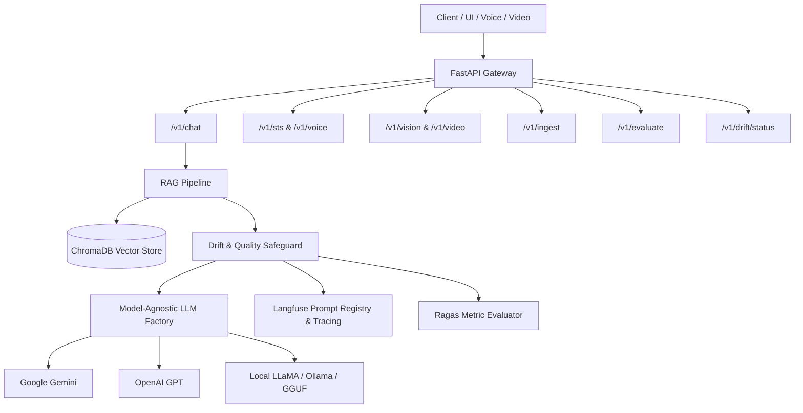

# HistoryVerse Local Chatbot & Microservices

HistoryVerse is a high-reliability, model-agnostic historical AI chatbot microservice suite.
It connects local historical documents (Alexandria, Egypt, Greco-Roman Museum, world history)
with LLMs (Google Gemini, OpenAI, or local GGUF/Ollama LLaMA models) via RAG, multimodal vision and video,
speech-to-speech (STS), and Langfuse experiment tracking with automated drift detection.

## Architecture



## Key Features

- **Model Agnostic**: Switch between Gemini, OpenAI, Ollama, or quantized GGUF models via `.env`.
- **Automatic Model Downloader**: Missing local models are fetched automatically from HuggingFace Hub.
- **Hardware Flexibility**: Configure execution on `cpu`, `cuda`, `mps`, or `auto`.
- **Speech-to-Speech (STS)**: Direct audio streaming input/output via Faster-Whisper and gTTS.
- **Multimodal Vision & Video**: Keyframe extraction and visual reasoning over historical sites and artifacts.
- **Experiment Tracking & Observability**: Traces, latencies, token consumption, and prompt versioning with Langfuse.
- **Quality Safeguards & Drift Auto-Retry**: Automatically re-runs low-confidence answers and triggers alerts or container rebuild hooks.
- **RAG Evaluation**: Ragas metrics (faithfulness, answer relevancy, context recall/precision).
- **Zero Hardcoding**: All options parameterized through Pydantic Settings.

## API Endpoints

| Method | Endpoint | Description |
|---|---|---|
| `GET` | `/health` | Service health status, active provider, model name, and uptime |
| `POST` | `/v1/chat` | Conversational RAG query with drift detection and history memory |
| `POST` | `/v1/voice` | Audio file upload with transcription and optional TTS output |
| `POST` | `/v1/sts` | Direct Speech-to-Speech audio streaming pipeline |
| `POST` | `/v1/vision` | Image artifact and site inspection |
| `POST` | `/v1/video` | Video sequence keyframe analysis |
| `POST` | `/v1/ingest` | Batch document parsing into ChromaDB with worker control |
| `POST` | `/v1/evaluate` | Ragas faithfulness and hallucination evaluation |
| `GET` | `/v1/drift/status` | Drift thresholds, max retries, fallback model, and action |

## Quickstart

### 1. Environment Setup

```bash
cp .env.example .env
# Edit .env to set your provider and API keys
```

### 2. Dependency Installation with `uv`

Install only what you need:

```bash
# Minimal core with Gemini:
uv pip install -e ".[gemini]"

# Or with local models:
uv pip install -e ".[local]"

# Or developer tools and testing:
uv pip install -e ".[dev]"
```

### 3. Ingestion

Place documents in `dataset/` and run:

```bash
curl -X POST http://localhost:8000/v1/ingest \
  -H "Content-Type: application/json" \
  -d '{"source_directory": "./dataset"}'
```

### 4. Running the Server

```bash
python -m historyverse
```

### 5. Docker Deployment

```bash
docker compose up -d --build
```

## Running Tests and Linting

```bash
uvx ruff check .
uvx ruff format --check .
pytest --cov=historyverse
```

## Contributing

See [`CONTRIBUTING.md`](CONTRIBUTING.md) and [`INTENT.md`](INTENT.md) for branch workflows and commit standards.
All contributions are authored by `@omarMohamedo-o`.
